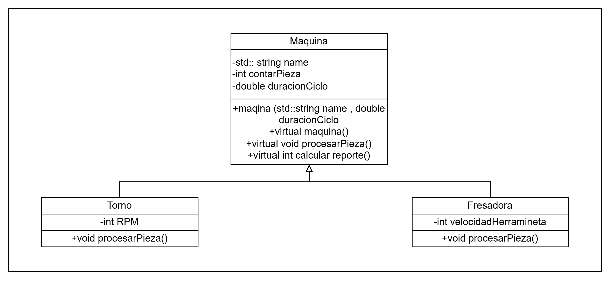
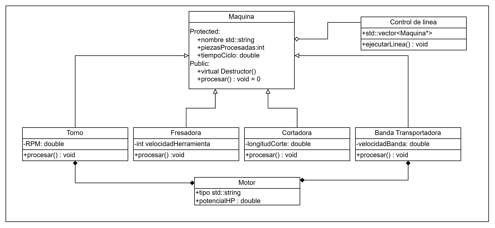

# Práctica Unidad IV: La evolución de una máquina

Programación Orientada a Objetos · Ingeniería Mecatrónica · Tercer semestre

Llena cada espacio conforme avances en las fases de [PRACTICA.md](PRACTICA.md).

## Fase 1. Entender el problema

**1.1 El problema con mis propias palabras**

[Una empresa manofacturera quiere mejorar el codigo de sus maquinas para hacerlas mes eficientes, buscan hacer una mejora en la clase maquina buscando un codigo mas completo de manera que impida errores antes de que sea cometan ]

**1.2 Reglas que siempre deben cumplirse en una máquina** (escribe al menos tres)

1. Una maquina no puede iniciar un ciclo de trabajo si no tiene un nombre valido
2. El tiempo de ciclos y el numero de piezas no puede ser negativo 
3. El estado de la maquina siempre debe de ser valido

**1.3 ¿Quién más usa la clase `Maquina`? ¿Qué podría salir mal si otro equipo crea una máquina nueva sin conocer tus reglas?**

[Al no encapsular el diseño de la clase otro programador podria modificar valores y corromper atributos, instanciar objetos en maquina provocando sesgos en los calculos]

## Fase 2. Diseñar la solución

**2.1 Diagrama inicial (Etapa 0)**

**2.2 Diagrama final (Etapa 9)**

**2.3 ¿Qué cambió entre los dos diagramas?**

| Elemento | Etapa 0 | Etapa 9 | Etapa que lo cambió |
| --- | --- | --- | --- |
| Visibilidad de los atributos de `Maquina` | public | protected | encapsulamiento |
| `procesar()` | normal | virtual puro (=0) | polimorfismo |
| `tiempoCicloSeg()` | atributo simple | metodo heredado | polimorfismo |
| Destructor de `Maquina` | no virtual | virtual | gestion de memoria |
| ¿Se pueden crear objetos `Maquina`? | si | no (no es abstracta) | polimorfismo |
| Relación `ControlDeLinea` - `Maquina` | No habia | agregacion con punteros | polimorfismo |
| Relación `Torno` - `Motor` | no existia | composicion  | composicion |
| Relación `BandaTransportadora` - `Motor` | no existia | composicion | composicion |

## Fase 3. Implementar

**3.0 Etapa 0. Una máquina sin reglas**

a) ¿Qué imprime `ejecutarTurno()` para el torno y la fresadora? ¿Por qué no imprime "torneando" ni "fresando"?

[Imprime los datos genericos de la clase base porque en la estapa 0 todavia no usabamos metodos virtuales ni polimorfismos, entonces el compilador solo ve el tipo maquina y no ejecuta el comportamiento espesifico de las hijas]

b) ¿Por qué el torno acumula 65 s y no 135 s?

[Porque solo acumulo el tiempo de un ciclo individual en lugar de sumar todas las operaciones completas de la linea]

**3.1 Etapa 1. Invariantes y constructores explicit**

a) ¿Qué regla de la sección 1.2 rompió `torno.piezasProcesadas = -5;`?

[El invariante de la calse ya que las piezas procesadas no pueden tener valores negativos]

b) ¿De dónde salió la máquina "Fantasma"? ¿Qué hizo el compilador sin que se lo pidieras?

[La creo el compilador automaticamente generando un constructor por defecto implicito al no definir nosotrs uno explicito]

c) ¿Qué tuviste que cambiar en `Torno` y `Fresadora` y por qué?

[agregamos explicit en los constructores para evitar que el compilador hiciera conversaciones implicitas de tipos no deseados]

**3.2 Etapa 2. Virtual y override**

a) La fresadora acumula 180 s, pero reporta 360 pzas/h. ¿Por qué un cálculo usó 60 s y el otro 10 s?

[Porque uno hizo la conversacion de tiempo usando la base de 60 segundos por minuto y el otro calculo la tasa proporcional para la hora]

b) ¿Tu compilador mostró alguna advertencia antes de usar `override`? ¿Qué mensaje dio después de agregar `override`?

[Antes no decia nada pero con override el compilador avisa si el metodo no esta sobreescribiendo correctamente a uno de las clases base]

**3.3 Etapa 3. La línea de producción**

a) ¿Por qué la línea procesó todo como "generico" si `procesar()` ya es virtual?

[Porque todavia estamos usandoobjetos por valor en lugar de punteros o referencias lo que cuasa rebanado de objetos]

b) ¿Por qué el torno y la fresadora originales quedaron con 0 piezas?

[Por culpa del rebanado de objetos ya que al copiarlos por valor a la coleccion se perdieron los datos originales y solo se guardo la parte base de maquina]

c) La relación entre `ControlDeLinea` y `Maquina`, ¿es composición o agregación? ¿Por qué?

[Es agregacion porque control de linea solo guarda punteros a las mauinas si se destruye el control, las maquinas se pueden seguir existiendo de forma independiente]

**3.4 Etapa 4. Destructores**

| Momento | Mensajes de destrucción que aparecieron |
| --- | --- |
| `delete temporal;` sin destructor virtual | solo destruyo la base y dejo la clase derivada |
| `delete temporal;` con destructor virtual | destruyo la clase derivada y luego base |
| Al terminar `main` (torno y fresadora) | se destruyeron completos porque se crearon por valor y no como puertos dinamicos |

a) ¿Qué advertencia mostró el compilador? ¿Por qué decimos que ya te estaba avisando del problema?

[aviso que una clase con metodos virtuales tiene un destructor no virtual, advirtiendo de borrados de objetos polimorficos]

b) ¿Por qué el torno de `main` sí se destruyó completo aunque el destructor no fuera virtual? ¿A qué máquina corresponde el primer "Destruyendo Maquina" después de "Fin de main"?

[Porque se creo por valor, no con new. El mensaje corresponde a limpiar la parte de las clase base del objeto]

**3.5 Etapa 5. La clase abstracta**

a) Copia los mensajes de error y explica con tus palabras qué dice cada uno.

[decia que no se puede instanciar una clase abstrcta porque tiene funciones virtuales puras sin cuerpo definido]

b) ¿Por qué es mejor este error de compilación que el comportamiento "generico" de antes?

[porque el compilador te detiene de inmediato en lugar de darte ejecutar un programa con errores logicos o comportamientos extraños]

**3.6 Etapa 6. El contrato que el compilador no ve**

a) ¿Qué partes del contrato violó `InspeccionVisual`?

[Ignoro las reglas de validacion o rangos establecidos en los comentarios del contrato para los parametros de entrada ]

b) ¿Por qué el compilador no lo detectó?

[Porque los contratos estaban establecidos como comentarios de texto y no como codigo ejecutable]

c) ¿Qué pasaría si el próximo equipo tampoco lee el comentario del contrato?

[volverian a introducir valores invalidos que romperian la logica de ejecucion del programa sin que nadie se enterara a tiempo]

**3.7 Etapa 7. La base hace cumplir el contrato**

a) ¿Cómo puede una clase derivada sobrescribir un método que es privado en la base?

[no se puede directamente, se cambia visibilidad a protegida para que las hijas tengan acceso pero se mantenga en encapsulamiento]

b) ¿Qué ocurre ahora con una máquina cuyo tiempo de ciclo es 0? Compáralo con la Etapa 6.

[ahora el progama lanza una exepcion y detiene la ejecucion inmeditamente, mientras que la etapa 6 pasaba desapersivida]

c) ¿Por qué la línea ignoró el "atajo" del torno, pero la llamada directa no? ¿Cómo corregiste el diseño?

[porque la llamada polimerica a traves de la intefaz generica solo ejecuta los metodos virtuales definidos, obligando a pasar por las reglas]

**3.8 Etapa 8. Herencia mal usada**

a) Da al menos dos razones por las que `BandaTransportadora : public Motor` es un error de diseño.

[una banda transportadora no es un motor sino que tiene un motor
heredar los metodos de motor publicamente en la banda y no nos permitiri cambiar o reutilizar el motor independientemente]

b) La relación entre `BandaTransportadora` y `Motor`, ¿es composición o agregación? ¿Por qué?

[es compocision porque el motor es una parte interna indispensable para la banda transportadora y un ciclo de vida esta igado a ella]

**3.9 Etapa 9. La librería y la prueba final**

a) Después de agregar la `Cortadora`, ¿qué archivos mostró `git status`? ¿Cuántos archivos de la librería tuviste que modificar?

[mostro cortadora.h y main.cpp. e la libreria no tuvimos que modificar ningun archivo gracias al polimorfismo]

b) ¿Qué pasó al escribir `-lplanta` antes de `src/main.cpp`? ¿Por qué?

[dio error de enlace, porque en g++ las librerias con -l deben colocarse despues de los archivos objeto o fuente que consumen sus simbolos]

**3.10 Bitácora de dudas**

| # | Etapa | Duda | Cómo la resolví | Fuente |
| --- | --- | --- | --- | --- |
| 1 | etapa 3  | porque el vector no guarda los cambios de las maquinas | guardando punteros en lugar de objetos con valor | clase/documentacion c++ | 
| 2 | etapa 4 | porque no se ejecuta los destructores de las clases hijas | declarando el destructor de la clase base como virtual | documentacion c++ |
| 3 | etapa 9 | error de enace al compilar la libreria | poniendo la bandera -planta al final del comando de compilacion| manual GCC/Terminal |

## Fase 4. Probar y mejorar

**4.1 Tabla de pruebas**

| # | Caso | Resultado esperado | Resultado obtenido | ¿Pasa? |
| --- | --- | --- | --- | --- |
| 1 | Máquina con nombre vacío | Excepción con mensaje claro | Exepcion con mensaje claro | si |
| 2 | Reporte de una línea vacía | "La linea no tiene maquinas" | "La linea no tiene maquinas" | si |
| 3 | `agregar(nullptr)` | Devuelve `false` | false | si |
| 4 | Reporte antes de ejecutar el turno | 0 piezas, 0 s y capacidad calculada | 0 piezas, 0 s y capacidad calculada | si |
| 5 | Turno de 0 ciclos | Nada cambia | sin cambios | si |
| 6 | Torno con 3 ciclos | 3 piezas, 135 s, 80 pzas/h | 3 piezas, 135 s, 80 pzas/h | si |
| 7 | Máquina con `tiempoCicloSeg()` igual a 0 | Excepción con mensaje claro | Excepción con mensaje claro | si |
| 8 | Máquina con `tiempoCicloSeg()` negativo | Excepción con mensaje claro | Excepción con mensaje claro | si |
| 9 | La misma máquina agregada dos veces | falso o rechaza duplicado | rechazado/falso | si |

**4.2 Bitácora de mejoras**

| # | Falla o mejora detectada | Qué cambié | Por qué |
| --- | --- | --- | --- |
| 1 | perdida de polimorfismo al compilar objetos | use un vector de punteros en lugar de objetos por valor | para evitar el revanado de objetos |
| 2 | registro de uga de memoria en las maquinas | declare el destructotor de la clase base como virtual | para asegurar que se liberen corectamente |

Retos opcionales que intenté: motor 

## Fase 5. Publicar en GitHub

**5.1 Enlace a mi fork**

[https://github.com/danielhernandez-commitsD/ulsa_ime_3_poo_evolucion_maquina]

## Cierre y reflexión

**6.1 Errores que ya no pueden ocurrir**

| Error | Etapa en que apareció | Restricción que lo impide ahora | ¿Quién lo detecta: el compilador o el programa? |
| --- | --- | --- | --- |
| Contadores con valores inválidos | etapa 1 | vadilacion y encapsulamiento | programa |
| Máquina "fantasma" creada a escondidas | etapa 1 | uso de explicit en constructores | compilador |
| Método que no sobrescribe por un `const` | etapa 2 | uso de override | compilador |
| Máquinas copiadas y "rebanadas" | etapa 3 | uso de punteros y polimorfismo | programa/compilador |
| Destrucción incompleta | etapa 4 | destructor virtual | compilador/programa |
| Máquina sin `procesar()` propio | etapa 5 | clase abstracta con metodo virtual puro | compilador |
| Tiempo de ciclo inválido | etapa 6/7 | bloques try catch y expreciones | programa |
| Derivada que no registra sus piezas | etapa 7 | reglas comunes en clase base | programa |

**6.2 ¿Cuál de los errores fue el más peligroso: el de compilación, la advertencia o el que compilaba sin problemas? ¿Por qué?**

[El que compila sin problemas, porque permitia ejecutar el programa con errores logicos y de rebanado]

**6.3 ¿Qué aprendiste en esta práctica?**

[aplicar correctamente los pilares de POO en c++ como polimorfimos, clase abstractas, manejo de memoria con destructores virtuales y control de expeciones  ]

**6.4 ¿Qué cambiarías de tu proceso la próxima vez?**

[usar mejores practicas de diseño modular desde el principio y estructurar los punteros y contratos de validacion antes de escribir todo el codigo]
